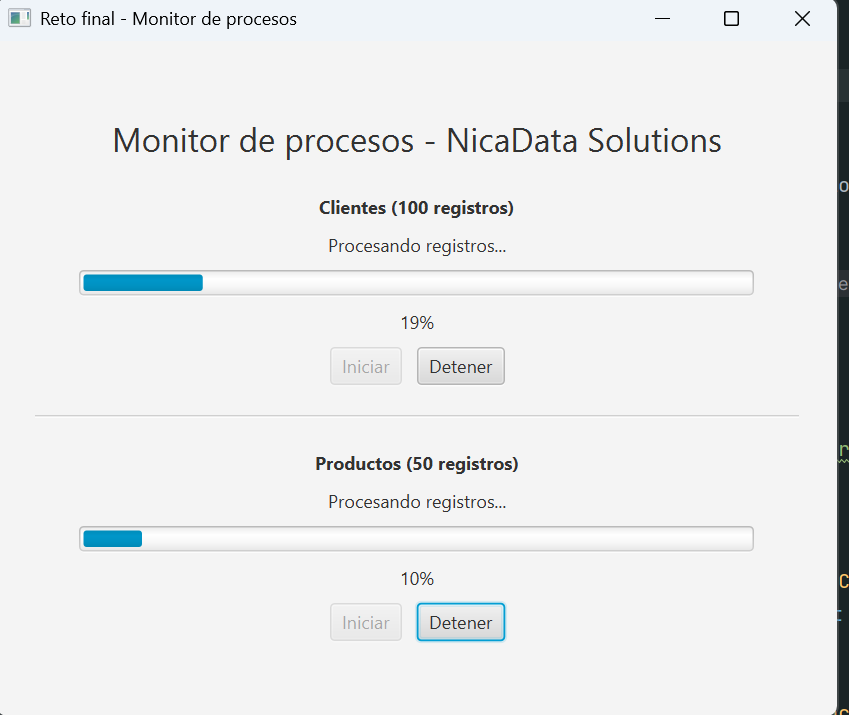
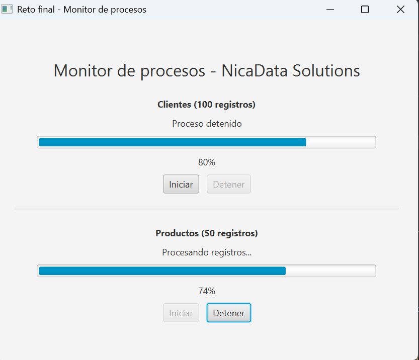

# JavaFX_Hilos_Practica

Práctica guiada: **Hilos en JavaFX** (Programación de Aplicaciones de Escritorio, Unidad III - Programación concurrente).
Caso de estudio: **NicaData Solutions S.A.**, simulación de procesamiento de registros sin bloquear la interfaz.

## Estructura

```
src/main/java/ni/edu/uam/practicahilos/practicahilosjavafx/
├── MainApp.java              # Aplicación base (procesador de 100 registros)
├── ProcesadorController.java # Hilo único: iniciar / detener / reiniciar
├── MonitorApp.java           # Reto final (monitor de dos procesos)
└── MonitorController.java    # Dos hilos independientes
src/main/resources/ni/edu/uam/practicahilos/practicahilosjavafx/
├── procesador-view.fxml
└── monitor-view.fxml
```

## Ejecución

- Práctica base: ejecutar `MainApp`.
- Reto final: ejecutar `MonitorApp`.

## Hilos implementados

### Práctica base (`ProcesadorController`)
- Un `Thread` creado con un `Runnable` procesa 100 registros (`Thread.sleep(100)` por registro, ~10 s).
- La interfaz se actualiza con `Platform.runLater()`, ya que los controles solo pueden modificarse desde el JavaFX Application Thread.
- **Detener:** `interrupt()` sobre el hilo; el `Runnable` captura `InterruptedException` y restablece los botones.
- **Reiniciar:** vuelve la barra a 0% si no hay un hilo activo.
- El hilo es daemon y se interrumpe al cerrar la ventana (`detenerAlCerrar()`).
- Se evita iniciar el proceso dos veces comprobando `isAlive()` y deshabilitando el botón Iniciar.

### Reto final (`MonitorController`)
| Proceso   | Registros | Espera por registro | Duración aprox. |
|-----------|-----------|---------------------|-----------------|
| Clientes  | 100       | 100 ms              | 10 s            |
| Productos | 50        | 250 ms              | 12,5 s          |

- Dos objetos `Thread` independientes, cada uno con su `Runnable`, su barra de progreso y su porcentaje.
- Cada proceso se detiene individualmente con su botón **Detener** (`interrupt()`).
- No se puede iniciar un proceso que ya está en ejecución (`isAlive()` + botón deshabilitado).
- Todas las actualizaciones visuales pasan por `Platform.runLater()`.

## Evidencia del reto final

Ambos procesos corriendo simultáneamente (Clientes 19%, Productos 10%):



Clientes detenido individualmente al 80% mientras Productos continúa (74%):



## Pregunta de análisis

**¿Por qué no debemos ejecutar procesos prolongados directamente dentro de los eventos de JavaFX?**

Los manejadores de eventos se ejecutan en el JavaFX Application Thread, el mismo hilo que dibuja la interfaz y atiende los eventos del usuario. Si un evento ejecuta una tarea larga (por ejemplo `Thread.sleep(5000)`), ese hilo queda ocupado y no puede redibujar ni responder a clics o al movimiento de la ventana; la aplicación parece congelada. Además, los cambios de `lblEstado` no se muestran hasta que el método termina. Por eso las tareas largas deben ir en hilos de segundo plano, y volver al hilo de JavaFX con `Platform.runLater()` solo para actualizar controles.
